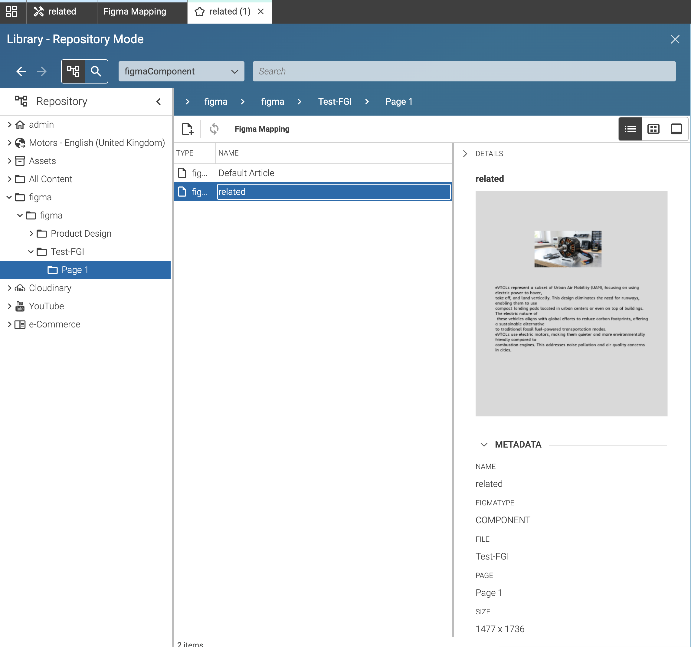
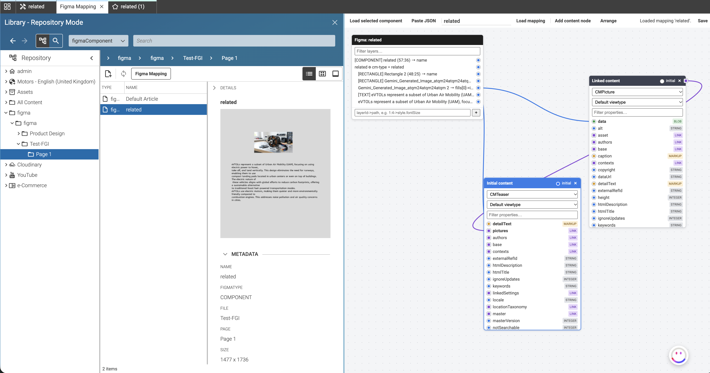

# Figma Extension for CoreMedia Content Hub

A CoreMedia Blueprint extension that connects Figma to the Studio **Content Hub**. Editors can browse Figma teams,
folders, files and pages in the Studio library and import components as content. A graphical **mapping editor**
defines how a Figma component becomes CoreMedia content: which layers fill which properties, which linked contents
are created, and which viewtype they use.



## Modules

| Module | Type | Extension point | Purpose |
|---|---|---|---|
| [`figma-studio-server`](figma-studio-server) | Maven JAR | `studio-lib` | Content Hub adapter, Figma API client, transformer and REST backend of the mapping editor |
| [`apps/studio-client/apps/main/figma-studio-plugin`](apps/studio-client/apps/main/figma-studio-plugin) | Jangaroo / Ext JS package | `studio-client.main` | "Figma Mapping" toolbar button and the node-based mapping editor |

The root `pom.xml` aggregates the server module. The client package is part of the pnpm workspace in
`apps/studio-client`.

## How it works

### Browsing

The adapter (`FigmaContentHubAdapter`, factory id `figma`) exposes this hierarchy in the Studio library:

```
Figma (root)
└── Team                         figmaTeam      (configured teamIds)
    └── Folder (nested)          figmaFolder    (Figma v2 folders API, or configured folderIds)
        ├── File                 figmaFile      (or configured fileKeys)
        └── Page                 figmaPage      (listed right after its file)
            └── Component        figmaComponent / figmaInstance
```

The children of a page are the components used on that page, i.e. its component, component set and instance
nodes. Thumbnails and preview renditions are rendered by the Figma images API.

External ids are the plain Figma ids (see `FigmaId`):

- `root` for the root folder
- `<teamId>` / `<folderId>` (numeric; resolved against the configuration and the folders of the configured teams)
- `<fileKey>` for a file
- `<fileKey>:<pageId>` for a page
- `<fileKey>:<pageId>~<nodeId>` for a component on a page

Figma has no search API, so `FigmaSearchService` walks the hierarchy below the selected folder and matches
component and instance names. It scans at most 30 pages per search and returns at most 100 hits by default, to stay
within the Figma rate limit.

### Importing

`FigmaContentHubTransformer` decides what a component becomes:

1. **With a transform description.** If the component has a component property `cm-type`, the description of that
   name is used. Descriptions are `CMSettings` contents in `/Settings/Options/Settings/Figma/<cm-type>`.
2. **Without a description.** A `CMChannel` is created with the component name as title, a link back to Figma in the
   detail text, and the Figma rendition as `data`.

A transform description is the `settings` struct of the CMSettings content:

```
initialType   String      content type to create
viewtype      String      optional, the key of a viewtype (its layout, or its name)
properties    Struct      property name -> mapping:
  String      "<layerId>-><jsonPath>"              value of a layer, e.g. "1:4->characters"
                                                   or "1:3->fills[0].imageRef" (image fill -> blob)
  Struct      {type: "CMPicture", properties: {…}} a new linked content, optionally with a viewtype
  StructList  [{type, properties}, …]              several new linked contents
  Struct      {layer: "1:9"}                       a new linked content, transformed with the
                                                   description named by that layer's cm-type
```

Notes:

- Linked contents are created through Content Hub references (`resolveReference`), nested at most 5 levels deep.
  Cycles between descriptions are detected.
- Viewtypes are resolved at import time for the user's preferred site. A site viewtype
  (`<site>/Options/Viewtypes`) overrides a global one (`/Settings/Options/Viewtypes`) with the same key. Viewtypes
  in subfolders named after the content type and its supertypes are included, the same way as in the Studio forms
  (`FigmaViewtypes`).
- Values are converted to the target property type. An `imageRef` is downloaded and stored as a blob. A mapping
  that cannot be applied is logged and skipped, and the rest of the import continues.
- Figma names such as `Button/Primary` are sanitized into valid content names.

### Mapping editor (Studio client)

`FigmaStudioPlugin` registers two things:

- **`FigmaToolbarPlugin`** adds a **Figma Mapping** button to the Content Hub library toolbar. The button is visible
  only for the `figma` connection or for Figma types, and opens the editor for the selected component or instance.
- **`FigmaMappingEditor`** is a work-area tab containing `FigmaNodeEditor`, a node graph drawn with DOM and SVG:
  - The Figma node on the left exposes layer values and nested components as output ports.
  - Each content node has a content type selector, a viewtype selector (for types with a `viewtype` property), its
    properties as input ports, and a `content` output port for linking into another node's link property.
  - Drag from a port to a property to link. Click a link to remove it. Drag the background to pan. Use Ctrl/Cmd +
    wheel to zoom. **Arrange** lays out the graph automatically.
  - You can load the component from the library selection or paste its JSON (the `document` from
    `GET /v1/files/:key/nodes`). **Save** writes the transform description.

`MappingGraph` converts between the graph model and the transform description format.



### REST backend

`FigmaMappingResource` is available in Studio under `/rest/api/figma` and is called by `FigmaApi.ts`:

| Method | Path | Result |
|---|---|---|
| GET | `figma/component?id=<contentHubObjectId>` | Node JSON of a component: `{id, name, cmType, node}` |
| GET | `figma/contenttypes` | Content types and their mappable properties |
| GET | `figma/viewtypes?type=<contentType>[&site=<siteId>]` | Applicable viewtypes: `[{key, name, path, site}]` |
| GET | `figma/descriptions` | Names of the existing transform descriptions |
| GET | `figma/descriptions/<name>` | One transform description |
| PUT | `figma/descriptions/<name>` | Creates or updates a transform description |

## Configuration

### Content Hub connection

Add a connection with factory id `figma` to the Content Hub settings. The Studio button looks for the connection id
`figma`. Connection `settings` (`FigmaContentHubSettings`):

| Setting | Description |
|---|---|
| `displayName` | Name of the root folder (default `Figma`) |
| `accessToken` | Figma personal access token or OAuth token (falls back to `contenthub.figma.access-token`) |
| `teamIds` | Team ids to browse: the number in `https://www.figma.com/files/team/<teamId>/…` |
| `folderIds` | Single folders shown directly below the root |
| `fileKeys` | Single files shown directly below the root: the path segment after `/design/` or `/file/` |
| `imageFormat` | Rendition format: `png` (default), `jpg` or `svg` |
| `imageScale` | Rendition scale from `0.01` to `4` (default `1`) |

If neither the connection nor the application properties provide an access token, the adapter cannot be created.

### Application properties

The Spring Boot auto-configuration `FigmaContentHubConfiguration` reads these properties (`FigmaProperties`):

| Property | Default | Description |
|---|---|---|
| `contenthub.figma.api-url` | `https://api.figma.com` | Base URL of the Figma REST API |
| `contenthub.figma.access-token` | – | Fallback token for connections without `accessToken` |
| `contenthub.figma.cache-ttl` | `5m` | Cache time of API responses and rendition URLs. Reloading a folder in Studio clears it early |
| `contenthub.figma.download-cache-ttl` | `1h` | Cache time of downloaded images (renditions, thumbnails, image fills) |
| `contenthub.figma.request-timeout` | `60s` | Timeout for API requests and image downloads |

All Figma calls go through the CoreMedia cache (`FigmaCacheKeys`) to protect the Figma rate limit. When Figma
returns HTTP 429, the error includes `Retry-After`, the rate-limit type, the plan tier and the upgrade link from the
response headers. Figma's limits depend on the seat of the token owner, and View/Collab seats get very few requests.

## Building

The modules are built as part of a CoreMedia Blueprint workspace, which provides the dependency versions and the
pnpm catalog.

```bash
# Server module
mvn clean install

# Studio client package (inside the Blueprint's studio-client workspace)
pnpm --filter @coremedia-blueprint/studio-client.main.content-hub-figma-studio build
pnpm --filter @coremedia-blueprint/studio-client.main.content-hub-figma-studio lint
```

## Tests

Unit tests in `figma-studio-server/src/test` cover id parsing, node value paths, component properties, transform
description parsing, viewtype resolution, the transformer and client caching.

`FigmaLiveTest` calls the real Figma API. It runs only when the following environment variables are set:

```bash
export FIGMA_TOKEN=<personal access token>
export FIGMA_TEAM_IDS=<id,id>      # and/or FIGMA_FOLDER_IDS / FIGMA_FILE_KEYS (comma separated)
mvn test -pl figma-studio-server
```
